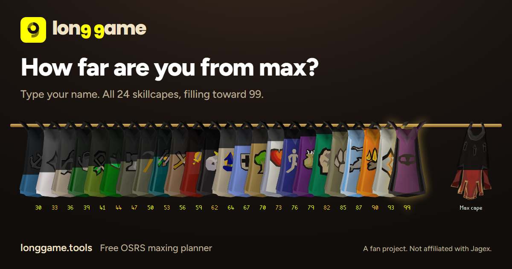

# Long Game

**A free maxing planner for Old School RuneScape.** Type your display name and see all 24 skillcapes on one rail, how far each is from 99, and a training session built for your account tonight.

**[longgame.tools](https://longgame.tools)**



Created using intellectual property belonging to Jagex Limited under the terms of Jagex's Fan Content Policy. This content is not endorsed by or affiliated with Jagex.

## Why I built it

I kept logging in to Old School RuneScape, standing at the bank, doing nothing, and logging off again. Not because there was nothing to do, but because deciding what to do was the hard part. Long Game makes that decision before I log in: it looks at what my account can do and tells me what tonight's session is.

## What it does

- **Shows the whole grind at once.** Every skill is a cape that fills with colour as you level, with the levels and hours left to max.
- **Deals you a session.** Say how long you have and how much attention you can spare, and it deals timed blocks from AFK, semi-AFK or active methods your account has actually unlocked, plus any farm or birdhouse runs that are due.
- **Plans for mains and ironmen separately.** It tells them apart from the hiscores. Ironmen get ironman routes, with no method that needs the Grand Exchange.
- **Asks only what it needs to.** The hiscores do not list quests or diaries, so it asks a few yes or no questions about the ones that would change your plan.
- **Tracks what you gained.** Finish a session and it tallies the XP, keeps a 14-day history and counts your streak.
- **Has a guide for every skill.** [Every training method](https://longgame.tools/guides/), with levels, XP rates and requirements.

## Using it

Go to [longgame.tools](https://longgame.tools) and type your display name. There is nothing to install and no account to create.

- **It only needs your name.** It looks you up on the public hiscores. It never asks for a password and cannot touch your account.
- **Your data stays with you.** Sessions, ticks and XP history are kept in your own browser. You can export them from Settings. The website counts visits with Cloudflare Web Analytics, which sets no cookies and does not follow you to other sites.
- **It is free.** No adverts, no donations, no paid features.

If you would rather keep your saves on your own machine, you can [run a local copy](#run-a-local-copy).

## Missing a method, or found a mistake?

The list of methods is not complete. Every method in it was checked against the Old School RuneScape Wiki, and there will be good ones I have missed. Rates are the wiki's and assume its setups, so your own will vary.

If you know a method that should be there, use "Suggest a method" on the Methods page or any guide page of the site, or [open an issue](https://github.com/ryandewick/longgame/issues). I check each one against the wiki before adding it, so a link to the wiki page helps.

---

## For developers

Long Game is a [Nuxt 4](https://nuxt.com) app in strict TypeScript, tested with Vitest and deployed as a Cloudflare Worker.

### How the code is put together

- **The rules of the game are pure functions** in `shared/domain`. They are handed the account, the time and the random source, so they are unit tested without a browser.
- **Three Pinia stores** (`account`, `session`, `history`) hold the state and ask the domain for everything derived from it.
- **Components only draw.** Each owns one BEM block named after the component and takes its colours and spacing from the tokens in `app/assets/styles/tokens.scss`.
- **Server routes are thin**, with their checks in `server/utils` as tested functions.
- **One codebase runs two ways:** the public website on Cloudflare, and a local copy on Node that keeps saves on disk.

[docs/ARCHITECTURE.md](docs/ARCHITECTURE.md) has the details, and [DESIGN.md](DESIGN.md) is the design system.

### What is in here

| Path                                 | What it is                                                                                      |
| ------------------------------------ | ----------------------------------------------------------------------------------------------- |
| `app/`                               | The Nuxt app: pages, components, stores, composables and styles                                 |
| `shared/domain/`                     | The rules: what an account can do, how long a skill will take, how a session is dealt           |
| `shared/data/`, `shared/types/`      | The training data as typed objects, built from `datasrc/`, and the types everything shares      |
| `server/`                            | The API routes (hiscores, account type, suggestions) and the sitemap, robots.txt and llms files |
| `datasrc/`                           | The training methods, quests and resets as JSON, each method with its wiki source               |
| `tests/`                             | The rules, the data, the text each screen shows, and the server's checks                        |
| `public/assets/`                     | Skill icons, skillcape images and the RuneScape font (Jagex's property), and the two open fonts |
| `modules/`, `wrangler.jsonc`         | The Cloudflare setup                                                                            |
| `tools/local-copy/`, `Long Game.bat` | Running a copy on your own machine                                                              |

### Getting started

Needs Node 24.11 or newer. With nvm, `nvm use` picks the version up from `.nvmrc`.

```
npm install
npm run dev
```

Then open the address it prints. Saves are kept in the browser, as on the live site.

### Checks

```
npm run check
```

That runs ESLint, the type check and every test. `npm run format` formats the code with Prettier.

### Build and deploy

The website is one Cloudflare Worker. Cloudflare serves the prerendered pages and static files, and the Worker answers `/api/*` and draws any page that was not prerendered.

```
npm run build:site      build with Nitro's cloudflare-module preset
npm run preview:site    run that build under Cloudflare's runtime on this machine (no login needed)
npm run deploy          build, then publish with wrangler
```

The suggestion form needs one secret on the Worker, `NUXT_GITHUB_TOKEN`: a fine-grained GitHub token with Issues: write on the repository that receives suggestions. Store it with `npx wrangler secret put NUXT_GITHUB_TOKEN`. Until it is set, the form answers that suggestions are not switched on.

### Run a local copy

A local copy is the same app on your own machine, with your sessions and XP history saved to disk.

On Windows, double-click `Long Game.bat`. The first run installs what it needs and builds, which takes a few minutes. After that it starts straight away and rebuilds by itself when the code has changed. It opens http://localhost:8765/ in your browser.

On anything else:

```
npm install
npm run build:local
npm run start:local
```

Saves are in the `.data` folder at the top of the project. To use another port, set `LONGGAME_PORT` first.

### Adding or correcting a method

Methods live in `datasrc/methods/<skill>.json`. Each one needs a level, a name, an XP rate where the wiki gives one, how much attention it takes, what it requires, and the wiki page it comes from. `npm run test` validates them and lists everything wrong with a file. Suggestions sent from the site arrive as GitHub issues labelled `method suggestion`.

### Quests and diaries

The hiscores do not list quests or diaries, and the OSRS Wiki does not permit other tools to use its service that reads them from the game. So there is no syncing: the app asks the player about the quests and diaries that would change their plan, and keeps a full tick list for the rest.

A quest cannot be finished before the quests it requires, so one answer settles several: ticking a quest ticks the quests it requires, and unticking one unticks the quests that require it. Those chains are in `datasrc/quest_prerequisites.json`, where each entry records the wiki page it came from. `npm run test` lists any of the app's quests that has no entry there.

## How this was built

Long Game was built with AI assistance. I set the direction and made the product and design decisions, and used Claude Code to write most of the code, which I review. Other projects on my profile are written entirely by hand, so I'm noting the difference here.

## Credits and licences

- **The code** is under the [MIT Licence](LICENSE). That covers the source code only, not the game assets or the training data below.
- **Game assets** (skill icons, skillcape images, the RuneScape font) belong to Jagex Limited and are used under Jagex's Fan Content Policy. They are not covered by the MIT Licence or any other licence in this repository.
- **Training data** in `datasrc/` is adapted from the [Old School RuneScape Wiki](https://oldschool.runescape.wiki/) and is licensed [CC BY-NC-SA 3.0](https://creativecommons.org/licenses/by-nc-sa/3.0/), the same as the wiki. That includes which quests require which (`datasrc/quest_prerequisites.json`), from the wiki's [Module:Questreq/data](https://oldschool.runescape.wiki/w/Module:Questreq/data) and, for the quests that module does not list, from each quest's own page.
- **GSAP** (the `gsap` package) is used under its own licence.
- **Figtree and Poppins**, the two open fonts, are under the SIL Open Font Licence. The licence texts are in `public/assets/fonts`.

Long Game is free and has no adverts, donations or paid features.
